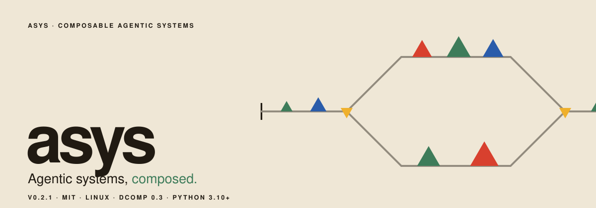
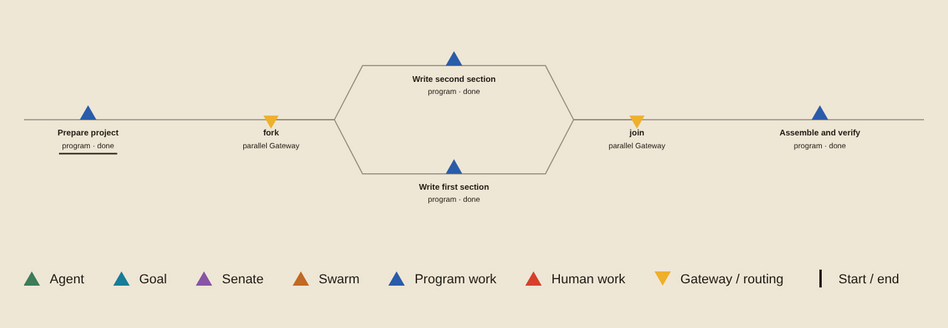
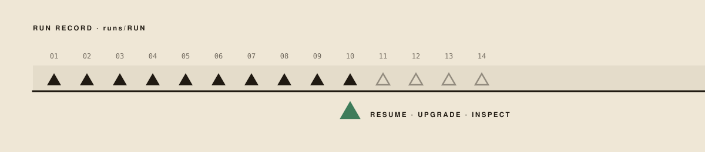

asys runs AI agents, ordinary programs and people together on a real project.
A single agent can take an assignment; a goal can be implemented and then checked
by an independent verifier; a group of agents can deliberate; and a BPMN
workflow can combine all of these with parallel steps, human decisions and
revision. Each run is recorded, so you can follow it while it works and see
afterwards what was done and why.

[Install](INSTALL.md) · [Start](#03--start) · [Workflows](skills/asys-authoring/references/workflows.md) · [Workers](skills/asys-authoring/references/workers.md) · [Operations](skills/asys/references/operations.md) · [Release notes](CHANGELOG.md)

- Jobs work in your project directory; logs, transcripts and reports are kept
  apart, in the run's record.
- A goal is accepted only when a fresh verifier agrees the whole request is met,
  and it asks a person when it is blocked.
- Human steps are typed questions that the workflow waits for, answered from a
  terminal.
- A failed workflow resumes from its checkpoint; a running one can move onto newly
  installed code without repeating finished work.
- Models come through [Pi](https://github.com/earendil-works/pi) behind one shared
  gateway, which keeps the credentials; agents never see them.
- It runs on Linux with Docker, composed by [dcomp](https://github.com/glguida/dcomp),
  and is MIT licensed.

## 01 · A run

Take a software change. An agent implements the request in the repository, and
a program runs the tests. The work then forks: a second agent reviews the change
while a person looks at the result. When both have answered, a final program
packages the work.


The workflow decides what happens next: accept the result, send it back for
another revision, or stop. Workers only carry out their assignment, with the
tools installed in their environment. Agents use the Pi coding-agent SDK,
programs run commands, and human steps wait for an answer. Workflows are
standard BPMN 2.0 XML with a small execution binding.

## 02 · Kinds of work

| Kind | What it does |
| --- | --- |
| **Agent** | One assignment, with tools, skills, memory and a saved conversation |
| **Goal** | Implements until an independent verifier accepts; asks a person when blocked |
| **Senate** | A princeps senatus and senators with professional roles deliberate and decide |
| **Swarm** | A population explores a separate world that measures its results |
| **Program** | A deterministic command with JSON input and output |
| **Human** | A person answers a typed question |

Each is an ordinary job: run one on its own with `asys-run`, or combine them in a
workflow. The dashboard draws every run as a map, one colour per kind of work:



[The mixed-review example](asys-bpmn/examples/mixed-review/) uses every kind: an
agent, two model swarms, a verified goal, a program checking their files, a
Senate, and a person who accepts, revises or stops.

## 03 · Start

[Install asys](INSTALL.md) with dcomp and Docker, create a state directory, and
check that execution works with the bundled workflow. It needs no model account:

```sh
make install
asys init ./state
source ./state/asys-env
asys-run asys-bpmn/examples/hello/env/dummy asys-bpmn/examples/hello/workflow.bpmn
asys logs latest
```

Then start inference, sign in to a provider and choose a default model:

```sh
asys-inference init
asys-inference start
asys-inference gateway login openai-codex --as work
asys-inference models
asys system-model set simple work/gpt-6.1-sol
```

Create an environment with a goal worker and give it a task on a project:

```sh
asys-workers add ./env/development goal repair
asys-run ./env/development repair "Fix the reported bug and independently verify the result" \
  --workspace ./project
asys dashboard
```

A workflow uses the same environment with a request file:

```sh
asys-run ./env/development ./workflow.bpmn --input request.md --workspace ./project
```

Human steps are answered from another terminal with `asys-human-prompt`.

## 04 · Following a run



A run keeps its requests, logs, agent transcripts, reports, results and workflow
checkpoints in the state directory, written so that a crash leaves a record you
can continue from:

```sh
asys top                    # live runs, jobs and transcripts
asys status latest          # jobs, results and errors
asys logs latest            # saved output, or one job's worker output
asys dashboard              # workflow maps, transcripts, Senates and swarm worlds
asys-run --resume RUN       # restart the failed stage of a workflow
```

`RUN` is a run ID from `asys ps`, any unique prefix of it, or `latest`.

## 05 · Updating

Each build is tagged with its version and commit, and an installation runs only
the images it installed:

```sh
make install                # or: sudo make install PREFIX=/usr/local
asys update                 # refresh shared services in the selected state
asys version                # what is installed, and what each service runs
```

When an update changes the interface workers use to reach models, `asys update`
first lets the affected runs finish their current jobs, replaces the services,
and then continues each workflow on the new release. Sign-ins are kept. A single
workflow can also be moved by hand with `asys-run --upgrade RUN`.

## 06 · Sharing a machine

A team can share one installation, one inference gateway with its signed-in
accounts, and one set of run records through a Unix group:

```sh
sudo make install PREFIX=/usr/local
sudo groupadd --force asys && sudo usermod -aG asys alice
sudo install -d -g asys -m 2770 /srv/asys
asys init /srv/asys/host --group asys        # as a group member, after logging in again
source /srv/asys/host/asys-env
```

Everyone sources the same `asys-env`, which also adds `{ host }` to the shell
prompt, so it is clear which setup a command affects. See
[state selection](INSTALL.md#select-state).

## 07 · Authoring

```sh
asys-workers add ./env/development agent editor
asys-workers add ./env/development senate review
asys-workers add ./env/development swarm search
asys-environment add-skill ./env/development ./skills/checking
asys dashboard --design ./my-design
```

An **environment** packages tools, prompts, skills and worker definitions, and
one environment can serve many workflows. Two portable skills ship with every
installation and teach an agent to operate and author asys:
[asys](skills/asys/SKILL.md) and [asys-authoring](skills/asys-authoring/SKILL.md);
export them with `asys skill DEST`. The dashboard's look is a separate
[design package](designs/default/) that can be replaced without changing code.

## Documentation

- [Installation and upgrade](INSTALL.md)
- [Commands and state](skills/asys/references/commands.md)
- [Monitoring and recovery](skills/asys/references/operations.md)
- [Environments and programs](skills/asys-authoring/references/environments.md)
- [Worker definitions](skills/asys-authoring/references/workers.md)
- [Workflows](skills/asys-authoring/references/workflows.md)
- [Human review](skills/asys-authoring/references/human.md)
- [Worlds](skills/asys-authoring/references/worlds.md)
- [Visual style guide](docs/styleguide.pdf)
- [Release notes](CHANGELOG.md)

Component internals are described in [runtime](asys-runtime/), [workers](asys-workers/),
[workflow engine](asys-bpmn/), [inference](asys-inference/) and
[Human service](asys-human-interface/).


